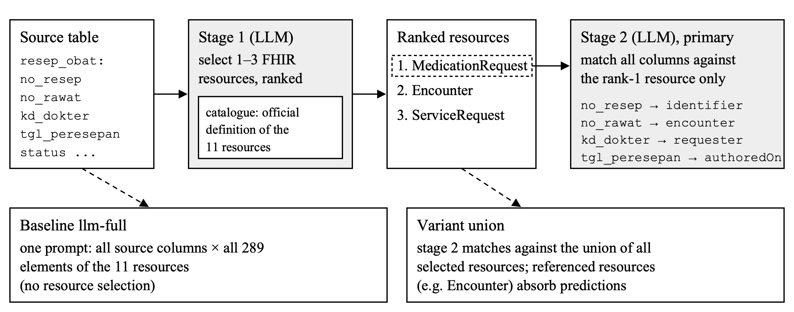

%title Single-Resource LLM Schema Matching of Indonesian Health Systems to FHIR
%authors [First Author]*^1^, [Second Author]^2^
%affil ^1,2^[Department, Faculty, University; address; country]
%email e-mail: *^1^[email], ^2^[email]

%abstrak
Fasilitas kesehatan di Indonesia wajib mengirim rekam medis elektronik ke platform SATUSEHAT dalam format HL7 FHIR R4, sehingga integrasi data menjadi masalah pencocokan skema antara skema basis data berbahasa Indonesia yang bersingkatan dan standar berbahasa Inggris. Kami membangun benchmark berisi 59 tabel dari tujuh sistem informasi kesehatan open-source Indonesia dengan 274 korespondensi beranotasi ke 289 elemen FHIR, di mana setiap tabel dipetakan ke satu resource FHIR, dibagi menjadi set pengembangan dan set uji yang dipra-registrasi. Pencocok klasik gagal pada skema ini (COMA R@|GT| 0,15 dibanding 0,53 untuk LLM 8B), dan ketika seluruh standar menjadi target, recall satu prompt LLM turun dari 0,55 ke 0,35 pada tabel pengembangan. Kami mengusulkan pencocok dua tahap yang memilih resource FHIR dari definisi resminya lalu mencocokkan kolom hanya ke resource peringkat pertama. Pada set pengembangan, recall naik 13,7 dan 12,7 poin untuk Qwen3-8B dan GLM-5.3-Flash dengan sekitar separuh token prompt; pada sistem uji, kenaikannya (12,2 dan 7,9 poin) searah tetapi belum terkonfirmasi secara statistik. Analisis galat menunjukkan bahwa hambatan utamanya adalah pemilihan resource, bukan pencocokan kolom, dan bahwa resource yang dirujuk lewat foreign key menyerap prediksi.
%katakunci pencocokan skema, large language model, HL7 FHIR, sistem informasi kesehatan, interoperabilitas

%abstract
Indonesian health facilities must report electronic medical records to the national SATUSEHAT platform in HL7 FHIR R4, which turns data integration into a schema-matching problem between abbreviated Indonesian database schemas and an English standard. We build a benchmark of 59 tables from seven open-source Indonesian health information systems with 274 annotated correspondences into 289 FHIR elements, in which each table maps to a single FHIR resource, split into a development set and a pre-registered held-out set. Classic matchers fail on these schemas (COMA R@|GT| 0.15 vs. 0.53 for an 8B LLM), and when the whole standard is the target, the recall of a single LLM prompt drops from 0.55 to 0.35 on development tables. We propose a two-stage matcher that selects the FHIR resource from its official definition and then matches columns only against the top-ranked resource. On the development set it improves recall by 13.7 and 12.7 points for Qwen3-8B and GLM-5.3-Flash at about half the prompt tokens; on held-out systems the gains (12.2 and 7.9 points) are directionally consistent but not statistically confirmed. Error analysis shows that resource selection, not column matching, is the bottleneck, and that resources referenced through foreign keys absorb predictions.
%keywords schema matching, large language models, HL7 FHIR, health information systems, interoperability

# 1. INTRODUCTION

Indonesia is moving its health data onto a national exchange. Minister of Health Regulation No. 24/2022 obliges every health facility, from independent practices and community health centres (*puskesmas*) to hospitals, to keep electronic medical records by the end of 2023 [@kemenkes2022]. The SATUSEHAT platform integrates these records using HL7 FHIR R4 [@kemenkes2023; @hl7fhir]. In parallel, the *Satu Data Indonesia* policy requires government data producers to follow shared data standards, metadata and interoperability rules [@perpres39]. For the thousands of facilities that run locally developed or open-source information systems, compliance is a schema-matching problem: an engineer has to decide which column of which local table corresponds to which element of which FHIR resource.

Schema matching has mature lexical and structural solutions such as Cupid [@cupid], COMA [@coma] and Similarity Flooding [@simflood], and frameworks such as Valentine compare them on common benchmarks [@valentine]. Learned matchers, from attention models trained on clinical schema pairs [@smat] to multi-task matching models [@unicorn], need labelled pairs that rarely exist for a new national standard. Large language models (LLMs) can match schemas from names and descriptions alone, although quality suffers both from too little and from too much context [@parciak]. Retrieval lets LLM matchers scale to large schemas without training data [@rematch], retrieve-and-rerank pipelines combine small and large models [@magneto], and Matchmaker composes candidate generation, refinement and confidence scoring into a self-improving program for medical schemas [@matchmaker]. Other work proposes unified LLM matching frameworks [@llmatch] or general data-preprocessing LLMs [@jellyfish]. In the biomedical domain, GDC-SM maps cancer-study data onto the Genomic Data Commons standard [@gdcsm], and FHIR-GPT transforms clinical text into FHIR resources [@fhirgpt]. Column-name abbreviation is a recognised problem in English tables [@nameguess; @columbo], and Indonesian NLP has benchmarks for generation and sentiment [@indonlg; @nusax], but not for data integration.

Two features of the Indonesian setting are not covered by this literature. The source schemas are Indonesian and often abbreviated (`kd_dokter`, `stts_nikah`, `tgl_registrasi`), while the standard is English; and a table must be mapped into a standard of hundreds of elements without knowing in advance which resource it belongs to. This paper studies the *single-resource* case, in which every table is exported as one FHIR resource plus references, in a zero-training, schema-only setting: no labelled pairs, no data values. Its contributions are: (i) a benchmark of 59 tables from seven open-source Indonesian systems mapped to FHIR R4, with annotation conventions, a development/held-out split and a pre-registered confirmation protocol; (ii) a two-stage matcher that first selects the target resource and then matches columns against that resource only, evaluated with two open model families; and (iii) an analysis that separates resource-selection errors from column-matching errors. We do not claim superiority over trained matchers, which we do not evaluate.

# 2. METHODS

## 2.1 Benchmark construction

A pilot with column headers from 18 Indonesian open-data portals showed that published open-data tables are an easy matching problem: only 6% of headers contained abbreviations, and COMA reached R@|GT| 0.93 on cross-portal pairs, on par with an LLM (0.90). Abbreviated naming lives in operational system schemas, so the benchmark is built from the DDL of open-source Indonesian information systems.

The target standard is HL7 FHIR R4 (4.0.1) [@hl7fhir]. We use 11 resources that cover the clinical and administrative core of a health information system: Patient, Practitioner, Organization, Location, Encounter, Condition, Observation, MedicationRequest, Medication, DiagnosticReport and ServiceRequest. Elements are taken from the official StructureDefinition snapshots at the top and backbone level, without datatype expansion and without technical elements (`id`, `meta`, `text`, extensions), giving 13–46 elements per resource and 289 in total. The development set (*dev41*) has 40 tables of SIMRS Khanza, the most widely used open-source hospital information system in Indonesia, plus one citizen table of OpenSID. The held-out set (*confirm18*) has 18 tables from six independent clinic and community-health code bases found on GitHub, one of which is the health module of OpenSID; OpenSID is therefore counted once and the benchmark covers seven systems (Table 1). We excluded systems derived from Khanza, schemas with English identifiers, and a dump that appeared to be the production schema of a real hospital, because its provenance was unclear.

Table 1 Benchmark statistics per source code base (FHIR pairs); abbreviated = column with a vowel-poor token or a two-letter acronym
| Set | Code base (licence) | Tables | Columns | Abbreviated | Gold 1:1 | n:1 | Ambiguous |
| dev41 | SIMRS Khanza, hospital (custom, non-commercial) | 40 | 526 | 59% | 195 | 81 | 30 |
| dev41 | OpenSID, citizen register (GPL-3.0) | 1 | 60 | 45% | 10 | 1 | 0 |
| confirm18 | puskesmas medical records, Laravel (MIT) | 5 | 51 | 53% | 22 | 3 | 5 |
| confirm18 | puskesmas queueing, Laravel (MIT) | 3 | 18 | 11% | 8 | 0 | 2 |
| confirm18 | clinic medical records, CodeIgniter (unclear) | 6 | 29 | 24% | 23 | 2 | 1 |
| confirm18 | posyandu growth monitoring (MIT) | 2 | 16 | 25% | 11 | 1 | 2 |
| confirm18 | student e-puskesmas project (unclear) | 1 | 5 | 20% | 2 | 0 | 0 |
| confirm18 | OpenSID health module (GPL-3.0) | 1 | 8 | 13% | 3 | 0 | 0 |
| Total | 8 code bases, 7 systems | 59 | 713 | 53% | 274 | 88 | 40 |

Each source table is paired with the one FHIR resource it would be exported as. Every source column receives one of four labels: *1:1* (the scored correspondence), *n:1* (a further column mapping onto an element already used, e.g. `jam_reg` → `period` when `tgl_registrasi` → `period` is the 1:1 link), *ambiguous* (two readings are defensible; a reason is recorded) or *none*. The conventions are: base FHIR R4 only, so SATUSEHAT extensions such as birth place and religion are true negatives; no datatype expansion; a foreign key reachable only through a join is ambiguous; a visit number in a non-visit table is a reference (`X.encounter`), not an identifier; in vital-sign tables the blood-pressure column maps to `component.value[x]` and the other vitals are n:1; and tariff and audit columns are negatives. Under these conventions all gold correspondences of a table lie in one resource. Table 2 shows the annotation of one development table.

Table 2 Annotation example: Khanza `reg_periksa` (outpatient registration) → FHIR Encounter
| Source column | Meaning | FHIR element | Label |
| no_rawat | visit number | identifier | 1:1 |
| tgl_registrasi | registration date | period | 1:1 |
| jam_reg | registration time | period | n:1 |
| kd_dokter | doctor code | participant.individual | 1:1 |
| no_rkm_medis | medical record number | subject | 1:1 |
| kd_poli | clinic code | location.location | 1:1 |
| stts | visit status | status | 1:1 |
| status_lanjut | outpatient / inpatient | class | 1:1 |
| kd_pj | payer code | account | ambiguous |
| hubunganpj | relation of responsible person | participant.type | ambiguous |

The gold standard was drafted by the first annotator and checked by a second annotator, blind to the draft, in two phases. In phase 1, the second annotator chose the FHIR resource of each table independently, from table and column names only; in phase 2, they labelled all 713 columns with the same four labels against the assigned resource. We report four agreement measures: resource selection (raw agreement and Cohen's κ over the 11 resources), annotation category (κ over the four labels), target element (κ over per-column elements, excluding columns that either annotator marked ambiguous), and exact (source column, FHIR element) pairs (F1 between the two sets of 1:1 links). Disagreements were resolved by discussion, and the adjudicated labels form the gold standard [TBD: the four agreement values, the number of labels changed by adjudication, and two examples of disagreements that changed the gold standard].

## 2.2 Matchers

All matchers see column names and types only, without data rows and without the source table name. Two target sizes are studied: the small target (*oracle*), which contains only the elements of the correct resource under bare names (`identifier`), and the large target, which is the union of all 11 resources (289 elements named `Resource.path`) with no indication of the correct one. The classic baselines are COMA, Cupid and Similarity Flooding through Valentine [@valentine], and the embedding baseline is cosine similarity of bge-m3 [@bgem3] over normalised names. The *llm-full* matcher sends one prompt with all source columns and all target elements: "You are a data-integration engineer doing schema matching. Find 1:1 correspondences between columns of the SOURCE and TARGET schemas (same real-world attribute, possibly different naming or language). Leave a source column unmatched if nothing fits", followed by the two column lists and a request for JSON `{source, target, confidence}` items. The *hybrid* matcher retrieves the top-k elements per source column with bge-m3 (k = 5, sensitivity k = 10) and one LLM prompt chooses among each column's candidates. This is the retrieve-and-rerank design of ReMatch and Magneto [@rematch; @magneto] without their training components; we do not compare with those systems or with Matchmaker [@matchmaker] directly because Magneto fine-tunes its retriever on generated data and Matchmaker optimises in-context demonstrations, which is outside the zero-training setting studied here.

The proposed *two-stage* matcher works as follows. In stage 1, the LLM receives the instruction "You are a data-integration engineer mapping a hospital database table to HL7 FHIR R4. Given the columns of one SOURCE table, choose the 1 to 3 FHIR resources its columns would be mapped into, most likely first. Choose fewer when one resource clearly fits", the source columns, and a catalogue of the 11 resources, each described by the root `definition` text of its StructureDefinition. In stage 2, the llm-full prompt is run against a reduced target, either the union of all selected resources (*union*) or only the rank-1 resource (*primary*). The primary variant follows from the single-resource setting. Figure 1 shows the pipeline.

Figure 1 Two-stage matcher with a single primary resource, illustrated with Khanza `resep_obat` (prescriptions); the ranking is the actual Qwen3-8B stage-1 output, while the mappings in the dashed box are gold correspondences shown for illustration, not model output

An abbreviation dictionary is mined from the Khanza DDL without gold data or external lexicons, from identifiers that differ in one token (`nm_pasien` ~ `nama_pasien`), initial letters (`jk` ~ `jenis_kelamin`), and vowel-poor tokens matched to vocabulary words that contain them as a subsequence. Its 201 entries have a precision of 75% (27 of 36) on tokens that occur in the evaluation tables and 25% (10 of 40, with 5 uncertain) on a random sample of other tokens, where medical acronyms dominate. With the dictionary on, a column is shown as `nm_pasien (nama pasien)`; a wrong expansion can mislead the model but never hides the original name. The same dictionary is applied unchanged to confirm18.

## 2.3 Models, metrics and statistics

Qwen3-8B [@qwen3] runs locally with Ollama 0.40.4 on a laptop (Apple M3 Pro, 18 GB), tag `qwen3:8b`, digest 500a1f067a9f (Q4_K_M quantisation), at temperature 0, seed 0, JSON mode and thinking disabled; embeddings use `bge-m3`, digest 790764642607 (F16). GLM-5.3-Flash [@glm] (open weights `zai-org/GLM-5.3-Flash`) is accessed through the Neuralwatt OpenAI-compatible API, model id `glm-5.3-flash`, on 28 October 2026, at temperature 0, seed 0, JSON mode and the minimum reasoning effort; the provider does not pin a checkpoint, so API results are reproducible from the released response cache rather than by re-querying. Prompts are byte-identical across models, configurations were developed on Qwen only, and every response is cached.

Evaluation of one table proceeds in four steps. (1) Parse the model's JSON into (source, target, confidence) triples. (2) R@|GT|: rank the predictions by confidence (ties keep the model's output order), take the top |GT|, and divide the number of gold 1:1 pairs among them by |GT|. (3) Decisions: assign greedily one-to-one by confidence over all predictions with confidence above 0, without using |GT|, and compute precision, recall and F1 against the gold 1:1 pairs. (4) Treat gold n:1 and ambiguous pairs under one of three policies. *Annotation-neutral* removes predictions that the gold standard labels n:1 or ambiguous before steps 2–3, so they are neither rewarded nor penalised; it measures performance on the scorable pairs and uses gold labels to filter, which a deployed system cannot do. *Deployment-strict* applies no gold-based filtering and counts every assigned pair that is not a gold 1:1 pair as a false positive, a lower bound on operational quality. *Deployment-lenient* counts assigned n:1 and ambiguous pairs as correct in precision, an upper reference. Formally, let G be the gold 1:1 pairs of a table, X its gold n:1 and ambiguous pairs, and A the greedy one-to-one assignment, computed once over all predictions for both deployment policies and over the predictions outside X for the annotation-neutral policy. Then P = |A ∩ G| / |A| under the strict and neutral policies and P = |A ∩ (G ∪ X)| / |A| under the lenient policy; for every policy R = |A ∩ G| / |G| and F1 = 2PR / (P + R) per table. Because the neutral assignment is computed without the predictions in X, an element they would have taken can go to a gold pair instead, so neutral F1 can exceed lenient F1. Annotation-neutral R@|GT| is the pre-registered metric; the deployment policies were added after the first review and fixed before they were computed. Precision, recall and F1 are computed per table and macro-averaged, so the reported F1 is the mean of per-table F1, not the harmonic mean of mean precision and recall. For example, for `resep_obat` with five gold pairs, Qwen's primary output ranks `status` → `status` (gold: `category`) first, then two gold pairs, then two wrong date columns, so R@|GT| is 2/5 = 0.40. The greedy assignment keeps six pairs, of which three are gold, because `authoredOn` is taken by a wrong column with higher confidence: P = 0.50, R = 0.60, F1 = 0.55. The n:1 prediction `jam_peresepan` → `authoredOn` is removed under the annotation-neutral policy, but it loses `authoredOn` in the assignment anyway, so all three policies agree here.

The table pair is the unit of analysis. Differences are computed from unrounded per-table values and reported with 95% bootstrap confidence intervals (10,000 resamples) and Wilcoxon signed-rank tests. The confirmatory analysis is limited to the pre-registered family of two hypotheses on confirm18 with Qwen3-8B and R@|GT|: H1, primary > llm-full, and H2, primary > union, tested one-sided with Holm correction. All other tests, including every GLM result, pooled sets and the correspondence-level analysis (cluster bootstrap and cluster sign-flip permutation over tables), are exploratory and uncorrected.

The pre-registration (configurations, hypotheses, metric, tests and the SHA-256 hashes of the confirm18 gold files) was written on 27 October 2026 before any matcher was run on confirm18, and the run script refuses to execute if the hashes differ. Analyses added after the first and second reviews (the deployment policies, oracle-B and the embedding baseline) are recorded in a dated addendum to the same file and are exploratory. It was not deposited with an external registry, so its timing cannot be verified independently; we follow the practice recommended in [@prereg] and release it with the code. Data and code availability: table and column names with types, gold annotations, guidelines, prompts, parser, cached model responses, pre-registration and statistics scripts are available at [repository URL, commit hash]; source dumps are not redistributed.

# 3. RESULTS AND DISCUSSION

## 3.1 Classic matchers and LLMs on abbreviated schemas

Table 3 compares schema-only matchers on the small target. On the control pairs, where names are nearly identical across two academic systems, every method reaches about 0.86. With abbreviations on one side (Khanza to the civil-registry export format SIAK or to OpenSID), classic matchers lose 30–40 points against the LLM, and when abbreviation is combined with a language switch (Khanza to FHIR), COMA drops to 0.15 while the LLM keeps 0.53.

Table 3 Schema-only baseline, R@|GT| on the small target (25 of the 28 baseline pairs; the three single-pair groups OpenSID→FHIR, SLiMS→Feeder and Khanza→Feeder are omitted)
| Method | Control (n = 6) | OpenSID→SIAK (n = 2) | Khanza→SIAK (n = 2) | Khanza→OpenSID (n = 1) | Khanza→FHIR (n = 14) |
| COMA | 0.861 | 0.690 | 0.580 | 0.444 | 0.153 |
| Similarity Flooding | 0.861 | 0.391 | 0.535 | 0.278 | 0.090 |
| Cupid | 0.335 | 0.186 | 0.000 | 0.000 | 0.048 |
| bge-m3 | 0.861 | 0.491 | 0.374 | 0.389 | 0.178 |
| Qwen3-8B | 0.817 | 0.758 | 0.864 | 0.778 | 0.528 |

On the 14 Khanza→FHIR pairs with the correct resource given, the dictionary raises the hybrid matcher by 14.1 points (k = 5, CI [7, 22], p = 0.008) and the embedding retriever by 8.3 points, but has no effect on llm-full (−0.9, p = 0.59), which already reads Khanza abbreviations. The hybrid stays below llm-full (−28.4 points without the dictionary, p = 0.002); its best variant only matches llm-full while using 3.5–4 times as many prompt tokens.

## 3.2 The large target and the two-stage matcher

Replacing the correct resource with the 289-element union lowers recall sharply. On the first 15 development tables, llm-full with dictionary falls from 0.55 to 0.35 and the hybrid to 0.18, because bge-m3 recall@10 drops to 0.40; 54–59% of llm-full predictions fall into a resource other than the gold one. Table 4 shows the main result.

Table 4 Large target (289 elements), R@|GT| with F1 in parentheses, and mean prompt tokens per table
| Configuration | Qwen3-8B dev41 | Qwen3-8B confirm18 | GLM dev41 | GLM confirm18 | Prompt tokens |
| llm-full | 0.270 (0.258) | 0.488 (0.435) | 0.556 (0.497) | 0.635 (0.569) | 1,870–1,940 |
| two-stage union | 0.338 (0.299) | 0.545 (0.453) | 0.581 (0.557) | 0.619 (0.579) | 980–1,340 |
| two-stage primary | 0.407 (0.389) | 0.611 (0.520) | 0.682 (0.653) | 0.714 (0.669) | 910–1,060 |
| oracle (resource given) | 0.552 (0.514) | 0.791 (0.732) | 0.764 (0.724) | 0.824 (0.795) | 250–310 |

Table 5 Primary minus llm-full in points [95% CI] from unrounded values, with Wilcoxon p; only the Qwen confirm18 R@|GT| test is confirmatory (one-sided, Holm-corrected), all others are exploratory
| Model and metric | dev41 | confirm18 | pooled (59 tables) |
| Qwen3-8B, R@|GT| (neutral) | +13.7 [3.8, 23.7], p = 0.011 | +12.2 [−0.2, 27.2], p = 0.138 | +13.2 [5.3, 21.5], p = 0.002 |
| Qwen3-8B, F1 (deployment-strict) | +13.0 [3.8, 22.2], p = 0.012 | +8.6 [−2.7, 21.1], p = 0.26 | +11.7 [4.4, 19.3], p = 0.004 |
| GLM-5.3-Flash, R@|GT| (neutral) | +12.7 [3.7, 21.7], p = 0.016 | +7.9 [−5.6, 22.2], p = 0.36 | +11.2 [3.8, 18.7], p = 0.010 |
| GLM-5.3-Flash, F1 (deployment-strict) | +14.6 [8.1, 21.2], p < 0.001 | +12.0 [0.5, 24.2], p = 0.037 | +13.8 [8.0, 19.5], p < 0.001 |

Table 6 evaluates the decisions a deployed matcher would output. Under the deployment-strict policy, which uses no gold labels, the primary variant again has the highest precision and recall of the non-oracle configurations for both models, and the three policies differ by at most 0.04 in F1, so the annotation-neutral filtering does not drive the result. Table 5 gives the paired differences.

Table 6 Decision-level precision, recall and F1 on all 59 tables (macro-averaged; P, R and the first F1 under the deployment-strict policy)
| Model | Configuration | P | R | F1 strict | F1 neutral | F1 lenient |
| Qwen3-8B | llm-full | 0.270 | 0.347 | 0.297 | 0.312 | 0.307 |
| Qwen3-8B | two-stage union | 0.292 | 0.396 | 0.330 | 0.346 | 0.343 |
| Qwen3-8B | two-stage primary | 0.374 | 0.486 | 0.414 | 0.429 | 0.425 |
| Qwen3-8B | oracle | 0.505 | 0.650 | 0.558 | 0.581 | 0.585 |
| GLM-5.3-Flash | llm-full | 0.442 | 0.586 | 0.494 | 0.519 | 0.521 |
| GLM-5.3-Flash | two-stage union | 0.502 | 0.611 | 0.544 | 0.563 | 0.569 |
| GLM-5.3-Flash | two-stage primary | 0.587 | 0.700 | 0.632 | 0.658 | 0.658 |
| GLM-5.3-Flash | oracle | 0.655 | 0.802 | 0.711 | 0.745 | 0.746 |

Restricting stage 2 to one resource is the effective ingredient. The union variant already halves the prompt, but its gain over llm-full is modest for Qwen (+6.8 points on dev41) and vanishes for GLM (+2.5 on dev41, −1.6 on confirm18), while the primary variant adds 7–10 points on top of union for both models. We distinguish three levels of evidence. Across model families, the development-set effect replicates: no design choice was made with GLM, and its effect (+12.7) is close to Qwen's (+13.7). On held-out systems, the effect is directionally consistent but not statistically confirmed: the pre-registered H1 has one-sided p = 0.069 (Holm-corrected 0.138), H2 has Holm-corrected p = 0.17, and the GLM gain is smaller (+7.9, p = 0.36). Thirteen of the 18 held-out tables are ties, because these schemas are smaller and less abbreviated (33% against 58% of columns). We therefore do not claim that the gain generalises across systems. Under the deployment-strict policy the GLM gain on confirm18 is +12.0 points (CI [0.5, 24.2], p = 0.037); this is exploratory evidence from an analysis added after the pre-registration and not corrected for multiplicity, not an independent confirmation of H1. A correspondence-level analysis gives the same ordering but no additional power (pooled +10.2 points, CI [1.4, 19.3], p = 0.029).

GLM is more accurate than Qwen in every configuration, by 21–29 points on dev41 and by 3–15 points on the easier confirm18. Table 7 shows why the primary variant works and where it fails. When stage 1 ranks the correct resource first, the primary variant reaches 0.728 (Qwen) and 0.833 (GLM), above the oracle on the same tables; when it does not, the primary variant scores 0, which is a consequence of the single-resource annotation protocol (all gold pairs of a table lie in its gold resource) rather than an empirical finding. For a correctly ranked table the primary prompt is identical to an oracle prompt that lists the gold resource's elements as `Resource.path` (*oracle-B*), whereas the oracle used elsewhere (*oracle-A*) lists bare names (`identifier`); the scores of primary and oracle-B coincide exactly on these tables for both models. Wrong rank-1 choices are concentrated: Qwen ranks Patient first for four staff tables, and Encounter or DiagnosticReport first for all ten referral, order and Observation tables it misses; GLM's errors are mostly Encounter (7 of 10).

Table 7 Stage-1 selection and stage-2 accuracy conditioned on it (all 59 tables; R@|GT| of primary and oracle-A on the same tables)
| Model | Top-1 dev41 | Top-1 confirm18 | Top-3 (all) | Rank-1 correct: n, primary, oracle | Rank-1 wrong: n, primary, oracle |
| Qwen3-8B | 26/41 | 12/18 | 53/59 | 38, 0.728, 0.669 | 21, 0.000, 0.546 |
| GLM-5.3-Flash | 34/41 | 15/18 | 54/59 | 49, 0.833, 0.809 | 10, 0.000, 0.650 |

Table 8 isolates the two components. Oracle-B exceeds oracle-A by 5.0 R@|GT| points for Qwen (CI [0.5, 9.5], p = 0.026) and by 2.1 for GLM (CI [−1.9, 6.3], p = 0.35; both exploratory), so the prefixed presentation helps the smaller model and has little measurable effect on the larger one. Replacing the LLM in stage 1 by an embedding classifier, which ranks resources by bge-m3 similarity between the expanded column names and each resource's definition, ranks the gold resource first for only 27% of tables; with the same stage-2 LLM it falls below llm-full (Qwen −11.9 points, GLM −36.0). LLM resource selection is therefore more effective than the two simple embedding classifiers we tested; this does not show that no non-LLM classifier could work.

Table 8 Target-format ablation and embedding-based resource selection on all 59 tables (R@|GT| annotation-neutral, F1 deployment-strict)
| Configuration | Qwen top-1 | Qwen R@|GT| | Qwen F1 | GLM top-1 | GLM R@|GT| | GLM F1 |
| oracle-A: gold resource, bare names | – | 0.625 | 0.558 | – | 0.782 | 0.711 |
| oracle-B: gold resource, Resource.path | – | 0.675 | 0.613 | – | 0.803 | 0.735 |
| primary, LLM stage 1 | 0.64 | 0.469 | 0.414 | 0.83 | 0.692 | 0.632 |
| primary, embedding stage 1 (definition) | 0.27 | 0.217 | 0.194 | 0.27 | 0.220 | 0.204 |
| primary, embedding stage 1 (definition + element names) | 0.24 | 0.189 | 0.168 | 0.24 | 0.197 | 0.183 |
| llm-full (no stage 1) | – | 0.337 | 0.297 | – | 0.580 | 0.494 |

The gain is also not uniform across resources (Table 9). It is largest for MedicationRequest, Organization and, for GLM, ServiceRequest, and negative where the rank-1 choice is often wrong, such as Practitioner for Qwen. Higher primary than oracle scores, e.g. Qwen on Condition, follow from the target-format difference in Table 8 and from small n.

Table 9 R@|GT| per FHIR resource on all 59 tables (n = tables)
| Resource | n | Qwen llm-full | Qwen primary | Qwen oracle | GLM llm-full | GLM primary | GLM oracle |
| Patient | 7 | 0.75 | 0.74 | 0.76 | 0.82 | 0.76 | 0.84 |
| Practitioner | 6 | 0.44 | 0.30 | 0.82 | 0.75 | 0.83 | 0.98 |
| Organization | 5 | 0.20 | 0.93 | 0.93 | 0.73 | 0.73 | 0.93 |
| Location | 6 | 0.65 | 0.75 | 0.88 | 0.78 | 0.58 | 0.92 |
| Encounter | 6 | 0.34 | 0.37 | 0.59 | 0.45 | 0.74 | 0.74 |
| Condition | 2 | 0.25 | 0.67 | 0.42 | 0.42 | 0.50 | 0.67 |
| Observation | 9 | 0.07 | 0.19 | 0.34 | 0.33 | 0.57 | 0.73 |
| MedicationRequest | 6 | 0.12 | 0.47 | 0.62 | 0.58 | 0.75 | 0.64 |
| Medication | 3 | 0.87 | 0.80 | 0.47 | 1.00 | 1.00 | 0.60 |
| DiagnosticReport | 3 | 0.06 | 0.36 | 0.30 | 0.07 | 0.42 | 0.69 |
| ServiceRequest | 6 | 0.06 | 0.00 | 0.55 | 0.41 | 0.67 | 0.69 |

Other design ablations on dev41 with Qwen did not change the configuration: the `definition` catalogue instead of the one-line `short` text gave +1.5 points, the full "Scope and Usage" text −0.1 to −2.1, choosing among separately matched resources by summed LLM confidence −10.2, and an Indonesian–English glossary hurt llm-full by 10–11 points (p = 0.03).

## 3.3 Error analysis

The largest failure is not linguistic. Almost every clinical Khanza table carries the visit number `no_rawat`, so stage 1 often includes Encounter, and in the union target the model then maps the table onto Encounter instead of the resource the table describes (Table 10). With GLM, the tables that include Encounter are not intrinsically harder (oracle 0.75 against 0.83), yet union recall drops from 0.82 to 0.32. For the referral table `rujuk`, with ServiceRequest selected, Qwen predicted `no_rujuk` → `Encounter.identifier` and `kd_dokter` → `Encounter.participant.individual` and scored 0 against an oracle of 0.62. Under the single-resource convention a foreign key such as `no_rawat` maps to `X.encounter`, which is why the primary variant works.

Table 10 Encounter absorption in the union target: dev41 tables whose gold resource is not Encounter and is among the stage-1 picks, split by whether Encounter is also picked
| Model | Encounter also picked | Tables | Share of top predictions in Encounter | Union R@|GT| | Oracle |
| Qwen3-8B | no | 18 | 0% | 0.61 | 0.68 |
| Qwen3-8B | yes | 15 | 60% | 0.13 | 0.41 |
| GLM-5.3-Flash | no | 22 | 0% | 0.82 | 0.83 |
| GLM-5.3-Flash | yes | 13 | 43% | 0.32 | 0.75 |

A second failure concerns FHIR modelling knowledge. With the one-line catalogue, Qwen never assigned the five referral and order tables to ServiceRequest. A glossary that labelled the column `rujuk_ke (EN: refer to)` left every stage-1 decision unchanged, so the model understands the Indonesian term but not the convention that a referral is a ServiceRequest. The `definition` catalogue, which mentions referrals, recovered three of the seven tables that the one-line catalogue missed, but longer specification text did not help further, consistent with reports that both too little and too much context hurt LLM matching [@parciak] and with long-context degradation [@lostmiddle]. Third, a negative instruction not to rank first a resource that the table only references, naming Encounter, Patient and Practitioner as examples, raised wrong rank-1 choices of Encounter from 7 to 14 of 41 tables, in line with known weaknesses of language models on negated prompts [@negated]. Finally, one held-out system uses generic column names (`id`, `nama`, `no_telepon`) that cannot be told apart without the table name; Qwen scores 0 there in every non-oracle configuration against an oracle of 0.89.

## 3.4 Efficiency, practical use and limitations

Table 11 reports the cost per table. The primary variant needs 47% fewer prompt tokens and 5–20% fewer output tokens than llm-full with both models. On the local model this shortens the median time from 19.4 to 16.1 seconds per table; through the API the second sequential call dominates and the primary variant is slower (3.2 against 2.0 seconds). One implication, which we have not tested with users, is that an engineer could confirm the selected resource before column matching; this would remove the zero-score cases of Table 7, but its cost, workload and the accuracy of human confirmation remain to be measured.

Table 11 Mean prompt and output tokens and median seconds per table (59 tables)
| Configuration | Qwen prompt | Qwen output | Qwen s | GLM prompt | GLM output | GLM s |
| llm-full | 1,918 | 342 | 19.4 | 1,914 | 333 | 2.0 |
| two-stage union | 1,287 | 395 | 17.1 | 1,153 | 326 | 3.3 |
| two-stage primary | 1,015 | 324 | 16.1 | 1,022 | 265 | 3.2 |
| oracle | 294 | 285 | 10.7 | 290 | 259 | 1.9 |

The study has limits. Its scope is single-resource matching: the conventions place all gold correspondences of a table in one resource, which the primary variant exploits. Tables that genuinely populate several resources, such as a registration table that creates both a Patient and an Encounter, are not measured. As a qualitative, exploratory check, we judged 30 random llm-full predictions that fell outside the gold resource on development tables; 6 were defensible under a multi-resource reading, mostly foreign keys pointing at the referenced resource. This sample is too small, and not an adjudicated alternative gold standard, to estimate how much the single-resource convention changes R@|GT| or F1. Per-table differences have a standard deviation of about 0.28, so effects of 10 points need 120–200 tables for 80% power, and the pre-registered test was underpowered. Each configuration was run once, and API decoding at temperature 0 is not guaranteed to be deterministic. The benchmark covers 11 of about 145 FHIR resources, uses names and types only, is dominated by one system in the development set, and its held-out set has now been used. All source schemas and the FHIR specification are public and may appear in training data, although our annotations do not [@contamination].

# 4. CONCLUSIONS

Mapping the database of an Indonesian hospital, clinic or community health centre onto FHIR is hard for classic matchers and far from solved for LLMs. When the whole standard is the target, recall drops sharply, and most errors put the right attribute into the wrong resource. In the single-resource setting, choosing the resource first from the standard's own definitions and then matching only against that resource improves recall by 12.7–13.7 points on development tables at about half the prompt tokens, for two open model families; on held-out systems the improvement is directionally consistent but not statistically confirmed. When the resource is chosen correctly, column matching is close to or above the oracle, so resource selection is the bottleneck. Human confirmation of the selected resource is a promising safeguard, although its practical cost and effectiveness remain to be evaluated.

# 5. FUTURE WORKS

Future work will enlarge the held-out set with more systems to reach adequate statistical power, extend the benchmark to tables that populate several resources, measure the effect of table names on schemas with generic columns, compare the mined dictionary with LLM-based abbreviation expansion [@columbo], and run the same tables in Indonesian, English and mixed variants to isolate the effect of language.

# ACKNOWLEDGEMENTS

[Optional: funding institution.]
